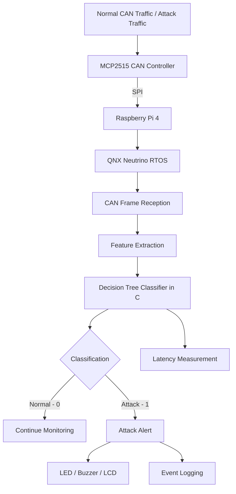
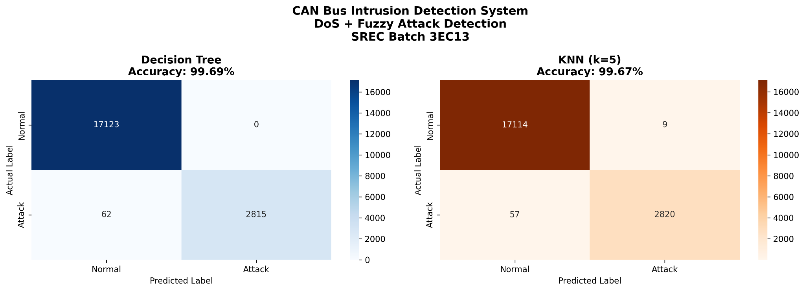
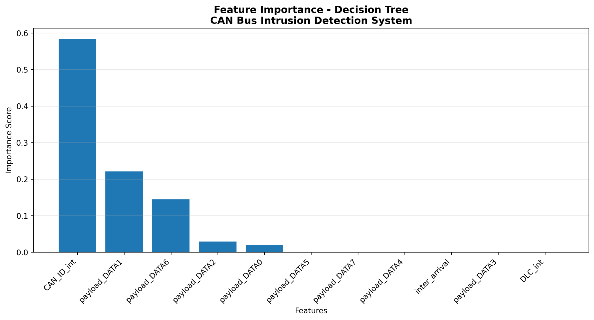

# 🚗 QNX-Based CAN Bus Intrusion Detection System
### Machine Learning–Driven DoS and Fuzzy Attack Detection for Automotive CAN Networks

An embedded automotive cybersecurity project designed to detect malicious communication on a Controller Area Network (CAN). The system uses machine-learning models trained on CAN intrusion data and exports the selected Decision Tree into portable C code for the intended deployment on a Raspberry Pi 4 running QNX Neutrino RTOS.

The project combines CAN traffic analysis, feature extraction, machine-learning classification, embedded C implementation, and a planned real-time hardware integration using an MCP2515 CAN controller.

> **Current implementation status:** The offline ML evaluation and generated C Decision Tree classifier are available. Live MCP2515 communication, complete QNX application integration, hardware alerts, and real-time latency validation are planned stages. They should not be considered completed until tested on the target hardware.

---

## 👨‍💻 Project Information

- **Project:** QNX-Based CAN Bus Intrusion Detection System
- **Domain:** Automotive Cybersecurity / Embedded Systems
- **Institution:** Sri Ramakrishna Engineering College (SREC)
- **Batch:** 3EC13
- **Selected ML Model:** Decision Tree
- **Target Platform:** Raspberry Pi 4 with QNX Neutrino RTOS
- **CAN Interface:** MCP2515

---

## 🏗️ System Architecture

The proposed system receives CAN frames, extracts the features required by the trained model, classifies each frame, and generates an alert when attack traffic is detected.



### Architecture Components

1. **CAN Network:** Carries communication frames between automotive Electronic Control Units (ECUs). Normal and attack traffic are used for system evaluation.
2. **CAN Interface (MCP2515):** Provides CAN frame reception through an SPI-connected CAN controller. The exact module must include or be connected to a compatible CAN transceiver.
3. **Embedded Processing Unit (Raspberry Pi 4):** Intended platform for running the intrusion-detection application.
4. **QNX RTOS:** Intended operating-system environment for scheduling the CAN reception, feature extraction, classification, and alert tasks.
5. **Machine Learning Classifier:** A trained Decision Tree exported into C conditional rules.
6. **Alert and Logging Unit:** Planned LED, buzzer, LCD, and event/latency logging functionality.

The architecture above represents the intended hardware deployment. The current `dt_classifier.c` file implements the classification rules; it does not contain the complete CAN driver, QNX task architecture, or physical alert implementation.

---

## 🛠️ Components & Features

### 1. CAN Bus Traffic Analysis

- Analyses CAN frames containing a CAN identifier, DLC, timestamp, and payload bytes.
- Uses the DoS and Fuzzy attack traffic files from the Car-Hacking CAN intrusion dataset collection.
- Maps dataset labels into two classes:
  - `0` – Normal traffic
  - `1` – Attack traffic

### 2. Machine Learning Model

Two algorithms were evaluated:

- **Decision Tree:** Selected for the C deployment path because its decision rules can be represented as conditional statements.
- **K-Nearest Neighbours (KNN):** Used as a comparison model with `k = 5` and Euclidean distance.

The Decision Tree achieved a reported offline accuracy of **99.69%**. The KNN model achieved **99.67%**.

### 3. C-Based Decision Tree Classifier

- Exports the trained Decision Tree into `src/dt_classifier.c`.
- Uses C conditional statements to classify a CAN frame.
- Returns `NORMAL (0)` or `ATTACK (1)`.
- Avoids requiring the Python runtime or loading a Python pickle model for C inference.

### 4. QNX-Based Real-Time Processing — Planned Integration

The intended QNX application separates the work into functional tasks:

- CAN Listener: receives frames from the MCP2515 interface.
- Feature Extractor: prepares the 11 model features.
- Classifier: executes the generated Decision Tree C function.
- Alert Manager: handles attack notifications.
- Logger: records classification and timing information.

QNX is selected for its real-time operating-system capabilities. A detection deadline is not claimed until it has been measured and validated on the actual target.

### 5. Hardware Alert System — Planned Integration

- Red LED for attack indication.
- Buzzer for audible warning.
- 16×2 I2C LCD for displaying system status.
- Event logging for later analysis.

---

## 📊 Dataset & Machine Learning Results

### Dataset Information

The project uses the DoS and Fuzzy traffic datasets from the Car-Hacking CAN intrusion dataset collection.

| Dataset detail | Value |
|---|---:|
| Dataset files | `DoS_dataset.csv`, `Fuzzy_dataset.csv` |
| Total parsed frames | 7,504,631 |
| Total ML samples | 100,000 |
| Normal samples | 85,617 |
| Attack samples | 14,383 |
| Number of features | 11 |

**Dataset labels:**

| Original label | Encoded label | Class |
|---|---:|---|
| `R` | 0 | Normal |
| `T` | 1 | Attack |

### Features Used

The model workflow uses the following 11 features:

1. `CAN_ID_int`
2. `DLC_int`
3. `inter_arrival`
4. `payload_DATA0`
5. `payload_DATA1`
6. `payload_DATA2`
7. `payload_DATA3`
8. `payload_DATA4`
9. `payload_DATA5`
10. `payload_DATA6`
11. `payload_DATA7`

- **CAN_ID_int:** CAN identifier converted to an integer.
- **DLC_int:** Data Length Code of the CAN frame.
- **inter_arrival:** Time difference between consecutive CAN frames.
- **payload_DATA0–payload_DATA7:** Individual CAN payload bytes.

The feature order, preprocessing, and time unit of `inter_arrival` must match the Python training pipeline during C deployment. The generated tree does not use every documented feature in its decision conditions; in particular, DLC does not appear in the current generated tree. Verify the training and inference pipelines before using live traffic.

### Model Comparison

| Metric | Decision Tree | KNN |
|---|---:|---:|
| Accuracy | **99.69%** | 99.67% |
| Training time | 0.436 seconds | 0.160 seconds |
| Tree depth | 8 | — |
| Leaf nodes | 20 | — |
| K value | — | 5 |
| ROC-AUC | 0.9952 | Not reported |

**Selected model:** Decision Tree, for its straightforward C implementation.

### Confusion Matrix



**Decision Tree confusion matrix:**

| Actual class | Predicted Normal | Predicted Attack |
|---|---:|---:|
| Normal | 17,123 | 0 |
| Attack | 62 | 2,815 |

The model correctly classified 17,123 normal samples and 2,815 attack samples in the reported evaluation. It misclassified 62 attack samples as normal. This false-negative count is important when evaluating an automotive intrusion-detection system.

### Feature Importance



The reported feature-importance plot shows `CAN_ID_int` as the most influential feature, followed by `payload_DATA1` and `payload_DATA6`.

These are model-derived importance scores; they do not establish that an individual feature is a universal or causal indicator of malicious CAN traffic.

---

## 📁 Project Structure

```text
CAN-Bus-Intrusion-Detection-QNX/
│
├── README.md
├── .gitignore
├── Makefile
│
├── src/
│   └── dt_classifier.c          # Generated C Decision Tree classifier
│
├── tests/
│   └── test_classifier.c        # C classifier smoke tests
│
├── docs/
│   └── feature_names.txt        # Model input feature list
│
├── models/
│   └── README.md                # Model artifact information
│
└── results/
    ├── model_results.txt        # Dataset and model evaluation details
    ├── confusion_matrices.png   # DT and KNN confusion matrices
    └── feature_importance.png   # Decision Tree feature importance
```

The raw dataset files and Python pickle files are not included in this repository. The C classifier is the selected inference artifact for the intended embedded deployment.

---

## 🔌 C Classifier Interface

The generated classifier is available at:

```text
src/dt_classifier.c
```

It defines the following CAN frame structure and function:

```c
typedef struct {
    uint32_t can_id;
    uint8_t  dlc;
    uint8_t  data[8];
    float    inter_arrival;
} CANFrame;

int classify_can_frame(const CANFrame *f);
```

### Classification Output

```text
0  → NORMAL
1  → ATTACK
```

### Example Usage

```c
#include <stdio.h>
#include "dt_classifier.c"

int main(void)
{
    CANFrame frame = {0};

    frame.can_id = 0x100;
    frame.dlc = 8;
    frame.inter_arrival = 1.0f;

    frame.data[0] = 0x01;
    frame.data[1] = 0x02;
    frame.data[2] = 0x03;
    frame.data[3] = 0x04;
    frame.data[4] = 0x05;
    frame.data[5] = 0x06;
    frame.data[6] = 0x07;
    frame.data[7] = 0x08;

    int result = classify_can_frame(&frame);

    if (result == ATTACK)
        printf("ATTACK DETECTED\n");
    else
        printf("NORMAL CAN FRAME\n");

    return 0;
}
```

This example demonstrates the classifier interface only. The sample values are illustrative and are not a validated normal-traffic test vector.

---

## 🔧 Hardware Requirements

The following components are planned for the hardware prototype:

| Component | Quantity | Purpose |
|---|---:|---|
| Raspberry Pi 4 Model B | 1 | Intended QNX processing unit |
| MCP2515 CAN module | 1 or 2 | CAN controller interface |
| ESP32 / Arduino with CAN interface | 1 | CAN traffic generation |
| 16×2 I2C LCD | 1 | Planned status display |
| Red LED | 1 | Planned attack indication |
| Active buzzer | 1 | Planned audible alert |
| 120 Ω resistors | As required | CAN bus termination |
| Breadboard and jumper wires | As required | Prototyping |
| Suitable regulated power supply | As required | Board and module power |

**Hardware note:** MCP2515 is a CAN controller, not a complete CAN transceiver. Confirm whether the selected breakout board includes a CAN transceiver. Check its supply and logic-level requirements before connecting it to the Raspberry Pi.

### Proposed CAN Network

```text
       CAN Traffic Generator
       (ESP32 / Arduino + CAN)
                 |
              CANH/CANL
                 |
          MCP2515 Module
                 |
                SPI
                 |
          Raspberry Pi 4
             (QNX RTOS)
```

Use a properly terminated, isolated bench CAN network for attack-injection experiments. Do not connect experimental attack traffic to a road vehicle.

---

## ⚙️ Setup & Installation

### 1. Offline Machine Learning Environment

**Prerequisites:**

- Python 3
- pip
- Pandas
- NumPy
- Scikit-learn
- Matplotlib
- Seaborn
- Joblib

Install the Python packages:

```bash
python -m pip install pandas numpy scikit-learn matplotlib seaborn joblib
```

The raw dataset files are not included in this repository. Obtain the datasets from the original provider and prepare the same preprocessing pipeline used for model training.

### 2. C Classifier Build and Test

**Prerequisites:**

- GCC or another compatible C compiler
- Make

From the repository root, run:

```bash
make test
```

To remove generated test binaries:

```bash
make clean
```

The included tests check selected classifier branches and the C interface. They are smoke tests, not a substitute for testing all held-out dataset samples.

### 3. QNX Development Environment — Target Setup

The intended target is Raspberry Pi 4 running a QNX Neutrino environment supported by the available QNX Software Development Platform (SDP) and board support package (BSP).

General setup sequence:

1. Obtain the appropriate QNX SDP through the official QNX developer program.
2. Confirm that a compatible Raspberry Pi 4 BSP is available for the selected QNX release.
3. Install the QNX development tools on a supported host system.
4. Configure the BSP and build or obtain the target image according to its official documentation.
5. Boot the supported image on the Raspberry Pi 4.
6. Verify the required SPI, CAN-controller, GPIO, and timing interfaces.
7. Build and integrate the C classifier into the QNX application.

Do not use a generic Raspberry Pi Linux image or assume that Linux MCP2515 drivers will work unchanged on QNX. Driver and BSP support must be verified for the exact target environment.

### 4. QNX Classifier Integration

The classifier source is portable C. Integrate it into the QNX application and connect it to the real CAN receive path.

Important integration checks:

- Match the C function name: `classify_can_frame()`.
- Use the same feature order and preprocessing as Python training.
- Calculate `inter_arrival` in the training-time unit and scale.
- Handle DLC values below 8 without reading uninitialised payload bytes.
- Compare C and Python predictions using identical test samples.

---

## 🧪 Testing & Validation

The following test cases are planned for the integrated system:

| Test ID | Test scenario | Expected result |
|---|---|---|
| TC-01 | Normal CAN traffic | NORMAL classification |
| TC-02 | DoS traffic | Detect attack traffic |
| TC-03 | Fuzzy traffic | Detect abnormal traffic |
| TC-04 | Mixed normal and attack traffic | Correct frame classification |
| TC-05 | Sustained CAN traffic | Check dropped frames and queue overflow |
| TC-06 | QNX target timing test | Record classifier and end-to-end latency |

### Performance Metrics

The integrated system should be evaluated using:

- Accuracy, precision, recall, and F1-score.
- False-positive and false-negative rates.
- Average classifier execution time.
- Maximum observed classifier execution time.
- End-to-end detection latency.
- CAN frame loss under sustained bus load.

The reported 99.69% accuracy is an offline evaluation result. No sub-2 ms detection guarantee is claimed. Such a claim requires target-hardware measurements under documented load conditions and a suitable real-time analysis.

---

## 📈 Results & Project Impact

| Parameter | Current reported result |
|---|---|
| Dataset samples | 100,000 |
| Decision Tree accuracy | 99.69% |
| KNN accuracy | 99.67% |
| Decision Tree ROC-AUC | 0.9952 |
| Decision Tree depth | 8 |
| Decision Tree leaf nodes | 20 |
| Selected deployment artifact | `dt_classifier.c` |
| Target platform | Raspberry Pi 4 + QNX (planned) |
| CAN interface | MCP2515 (planned integration) |
| Attack categories evaluated | DoS and Fuzzy |

The project demonstrates an offline ML-to-C deployment workflow for automotive CAN intrusion detection. The next engineering milestone is validating the generated C classifier against Python predictions and integrating it with live CAN traffic on the intended QNX target.

---

## 🚀 Future Enhancements

- Integrate actual MCP2515 CAN frame reception.
- Complete the QNX application and target-board integration.
- Implement hardware alerts using LED, buzzer, and LCD.
- Validate C predictions against the Python model on identical test samples.
- Measure classifier execution time and end-to-end latency under CAN bus load.
- Evaluate additional attack categories such as spoofing and replay attacks.
- Test generalisation on separate traffic captures and unseen attack scenarios.
- Improve false-negative performance and evaluate robustness against changing CAN traffic patterns.

---

## 📚 References & Resources

1. **Car-Hacking CAN Intrusion Dataset:** [Hacking and Countermeasure Research Lab](https://ocslab.hksecurity.net/Dataset/CAN-intrusion-dataset)
2. **Bosch CAN Protocol Information:** [Bosch Semiconductors](https://www.bosch-semiconductors.com/ip-modules/can-protocols/)
3. **MCP2515 CAN Controller:** [Microchip Technology](https://www.microchip.com/en-us/product/MCP2515)
4. **QNX Developer Documentation:** [QNX Documentation](https://www.qnx.com/developers/docs/)
5. **Scikit-learn Decision Trees:** [Scikit-learn Documentation](https://scikit-learn.org/stable/modules/tree.html)

---

## 🛡️ Safety & Project Disclaimer

This project is an academic/research prototype for controlled CAN-bus security experiments. It is not a production automotive safety system and must not be used to control or protect a road vehicle.

Do not inject attack traffic into a vehicle or public CAN network. Perform experiments only on an isolated bench setup with equipment you are authorised to test.

---

**Project Domain:** Automotive Cybersecurity | Embedded C | Machine Learning | CAN Protocol | QNX RTOS

**Target Application:** Real-time intrusion detection for automotive CAN networks.
